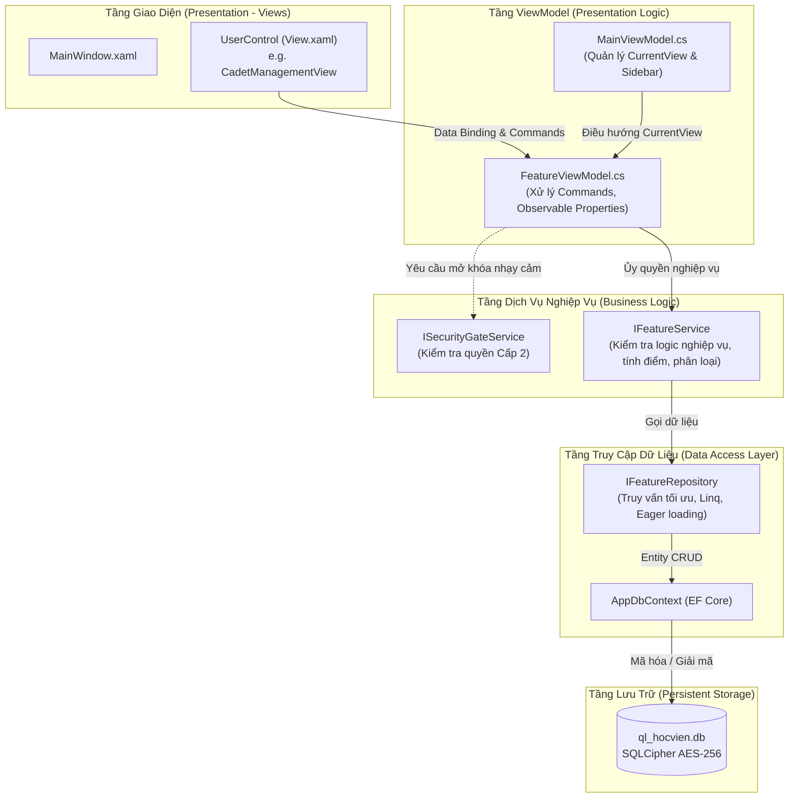
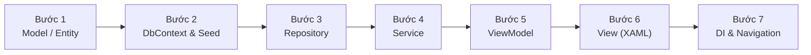

# 🏛️ CẨM NANG KIẾN TRÚC & QUY TRÌNH PHÁT TRIỂN CHỨC NĂNG MỚI
### *Dành cho Nhà phát triển Ứng dụng Desktop WPF (.NET 8) — QL_HocVien*

---

## 📌 MỤC LỤC
1. [Tổng Quan Kiến Trúc & Ngăn Xếp Công Nghệ](#1-tổng-quan-kiến-trúc--ngăn-xếp-công-nghệ)
2. [Bản Đồ Cấu Trúc Thư Mục Dự Án](#2-bản-đồ-cấu-trúc-thư-mục-dự-án)
3. [Mô Hình Kiến Trúc & Luồng Dữ Liệu (MVVM + Layered)](#3-mô-hình-kiến-trúc--luồng-dữ-liệu-mvvm--layered)
4. [Các Quy Chuẩn Cốt Lõi (Core Conventions & Best Practices)](#4-các-quy-chuẩn-cốt-lõi-core-conventions--best-practices)
   - [Quy chuẩn MVVM & CommunityToolkit.Mvvm](#41-quy-chuẩn-mvvm--communitytoolkitmvvm)
   - [Quy chuẩn Dual-Theme Engine (Tác chiến ⮂ Hành chính)](#42-quy-chuẩn-dual-theme-engine-tác-chiến--hành-chính)
   - [Quy chuẩn Bảo mật (Security Gate & SQLCipher AES-256)](#43-quy-chuẩn-bảo-mật-security-gate--sqlcipher-aes-256)
   - [Quy chuẩn Quản lý Luồng & Bất đồng bộ (Async/Await)](#44-quy-chuẩn-quản-lý-luồng--bất-đồng-bộ-asyncawait)
5. [Quy Trình 7 Bước Thêm Một Tính Năng Mới (Step-by-Step Feature Workflow)](#5-quy-trình-7-bước-thêm-một-tính-năng-mới-step-by-step-feature-workflow)
   - [Bước 1: Định nghĩa Model / Entity](#bước-1-định-nghĩa-model--entity)
   - [Bước 2: Cấu hình DbContext & Database Seed](#bước-2-cấu-hình-dbcontext--database-seed)
   - [Bước 3: Xây dựng Repository (Interface & Implementation)](#bước-3-xây-dựng-repository-interface--implementation)
   - [Bước 4: Xây dựng Service (Business Logic & Validation)](#bước-4-xây-dựng-service-business-logic--validation)
   - [Bước 5: Xây dựng ViewModel (Presentation Logic & Commands)](#bước-5-xây-dựng-viewmodel-presentation-logic--commands)
   - [Bước 6: Thiết kế Giao diện View (UserControl XAML)](#bước-6-thiết-kế-giao-diện-view-usercontrol-xaml)
   - [Bước 7: Đăng ký DI Container & Navigation System](#bước-7-đăng-ký-di-container--navigation-system)
6. [Ví Dụ Thực Tế Mẫu Hoàn Chỉnh: Module "Khen Thưởng - Kỷ Luật"](#6-ví-dụ-thực-tế-mẫu-hoàn-chỉnh-module-khen-thưởng---kỷ-luật)
7. [Quy Trình Viết Kiểm Thử Tự Động (Unit Testing)](#7-quy-trình-viết-kiểm-thử-tự-động-unit-testing)
8. [Cẩm Nang Xử Lý Sự Cố & Lỗi Thường Gặp (Troubleshooting)](#8-cẩm-nang-xử-lý-sự-cố--lỗi-thường-gặp-troubleshooting)

---

## 1. TỔNG QUAN KIẾN TRÚC & NGĂN XẾP CÔNG NGHỆ

Dự án **QL_HocVien** là ứng dụng Windows Desktop chuyên biệt phục vụ công tác quản lý quân số, đào tạo học viên và sĩ quan chỉ huy trong môi trường quân đội. Ứng dụng được thiết kế theo tiêu chí: **100% Offline-First**, **Bảo mật cấp độ cao (SQLCipher AES-256)**, **Giao diện tác chiến hiện đại** và **Tuân thủ nguyên lý Clean Architecture / SOLID**.

### 🛠️ Ngăn xếp công nghệ chính (Tech Stack)
| Thành phần | Công nghệ / Thư viện | Mục đích sử dụng |
|---|---|---|
| **Platform** | `.NET 8.0-windows` (C# 12) | Nền tảng desktop hiện đại của Microsoft, hiệu năng cao. |
| **Giao diện** | `WPF` (Windows Presentation Foundation) | Công nghệ đồ họa vector XAML, hỗ trợ Data Binding và Styling mạnh mẽ. |
| **Mô hình kiến trúc** | `MVVM` (Model-View-ViewModel) | Tách biệt hoàn toàn tầng Giao diện (UI) và Tầng Logic nghiệp vụ. |
| **MVVM Toolkit** | `CommunityToolkit.Mvvm (v8.4.2)` | Source Generators: `[ObservableProperty]`, `[RelayCommand]`, tối ưu boilerplate. |
| **IoC / DI** | `Microsoft.Extensions.DependencyInjection (v8.0.0)` | Quản lý phụ thuộc, vòng đời dịch vụ (Transient, Scoped, Singleton). |
| **ORM / Data Access** | `Microsoft.EntityFrameworkCore.Sqlite.Core (v8.0.8)` | ORM tương tác với CSDL SQLite cục bộ qua Repository Pattern. |
| **Mã hóa CSDL** | `SQLitePCLRaw.bundle_e_sqlcipher (v2.1.8)` | Mã hóa toàn bộ tập tin `ql_hocvien.db` bằng thuật toán chuẩn AES-256. |
| **Bảo mật Khóa** | `DPAPI` + `System.Security.Cryptography` | Khóa ràng buộc mã máy (Hardware Fingerprint) và bảo vệ Master Key. |
| **Xử lý Excel** | `ClosedXML (v0.105.1)` | Xuất/nhập danh sách học viên, bảng điểm tín chỉ, thống kê quân số. |
| **Kiểm thử** | `xUnit (v2.5.3)` + `TestDoubles (InMemory DB)` | Bộ Unit Test tự động cho toàn bộ Service và Repository. |

---

## 2. BẢN ĐỒ CẤU TRÚC THƯ MỤC DỰ ÁN

```text
D:\AppDesktop\QL_HocVien\
│
├── App.xaml / App.xaml.cs          # Điểm khởi chạy (Entry Point), cấu hình DI, xử lý Crash log toàn cục
├── QL_HocVien.csproj               # Cấu hình project, gói NuGet, điều kiện Publish Single-file
├── ql_hocvien.db                   # Tập tin CSDL SQLite mã hóa AES-256
├── appsettings.json                # Cấu hình hệ thống (Phiên bản, tham số ngầm)
│
├── Models\                         # [TẦNG DỮ LIỆU]
│   ├── Entity\                     # Thực thể CSDL (User, Cadet, MilitaryClass, AcademicCohort...)
│   ├── DTOs\                       # Đối tượng truyền dữ liệu (CadetSummaryDto, AnalyticsDto...)
│   └── Filters\                    # Lớp điều kiện lọc dữ liệu (CadetFilterCriteria...)
│
├── Data\                           # [TẦNG TRUY CẬP DỮ LIỆU - DAL]
│   ├── AppDbContext.cs             # DbContext của EF Core, cấu hình Fluent API
│   ├── DbInitializer.cs            # Khởi tạo bảng CSDL và seed dữ liệu mẫu ban đầu
│   ├── SqlCipherMigrator.cs        # Tự động mã hóa CSDL nếu phát hiện file plaintext
│   └── Repositories\
│       ├── Interfaces\             # Hợp đồng Repo (IRepository<T>, ICadetRepository...)
│       └── Implementations\        # Triển khai Repo (Repository<T>, CadetRepository...)
│
├── Services\                       # [TẦNG NGHIỆP VỤ - BLL]
│   ├── Interfaces\                 # Hợp đồng dịch vụ (ICadetService, IAuthService...)
│   ├── Implementations\            # Triển khai logic nghiệp vụ (CadetService, AuthService...)
│   └── Calculators\                # Bộ tính toán chuyên biệt (CreditGradeCalculator, PhysicalExamCalculator)
│
├── ViewModels\                     # [TẦNG ĐIỀU HƯỚNG & TRÌNH DIỄN - PRESENTATION LOGIC]
│   ├── ViewModelBase.cs            # Lớp cơ sở (IsBusy, StatusMessage, ErrorMessage...)
│   ├── MainViewModel.cs            # ViewModel gốc điều khiển Shell chính và Navigation
│   ├── DashboardViewModel.cs       # Màn hình Trung tâm chỉ huy / Dashboard
│   ├── CadetManagementViewModel.cs # Quản lý danh sách học viên
│   └── ...                         # Các ViewModel chức năng khác
│
├── Views\                          # [TẦNG GIAO DIỆN - UI]
│   ├── Windows\                    # Cửa sổ chính (MainWindow.xaml, LoginWindow.xaml...)
│   ├── UserControls\               # Giao diện từng trang (CadetManagementView.xaml...)
│   └── Components\                 # Control tái sử dụng (UnitTreeComboBox.xaml...)
│
├── Styles\                         # [GIAO DIỆN & DUAL-THEME]
│   └── MilitaryTheme.xaml          # Từ điển tài nguyên (Button, TextBox, DataGrid, Dual-Theme Brushes)
│
├── Converters\                     # Value Converters cho XAML (BooleanToVisibilityConverter, etc.)
├── Helpers\                        # Lớp tiện ích tĩnh (PasswordHasher, StringHelper, HardwareInfo...)
├── Infrastructure\                 # Thành phần hạ tầng kỹ thuật (Validation, Security Gate, Factory...)
└── QL_HocVien.Tests\               # Dự án xUnit kiểm thử độc lập (Repositories, Services, Security)
```

---

## 3. MÔ HÌNH KIẾN TRÚC & LUỒNG DỮ LIỆU (MVVM + LAYERED)

Ứng dụng tuân thủ mô hình **Clean Layered Architecture** kết hợp với mẫu thiết kế **MVVM (Model-View-ViewModel)**.



### Luồng điều hướng View (ViewModel-First Navigation Pattern):
1. `MainWindow.xaml` chứa một `ContentControl` được bind: `Content="{Binding CurrentView}"`.
2. Trong `MainWindow.Resources`, mỗi `ViewModel` được ghép đôi với một `UserControl (View)` thông qua các thẻ **DataTemplate** ngầm định:
   ```xml
   <DataTemplate DataType="{x:Type vm:CadetManagementViewModel}">
       <views:CadetManagementView/>
   </DataTemplate>
   ```
3. Khi người dùng click một Menu ở Sidebar, `MainViewModel` thay đổi thuộc tính `CurrentView` sang đối tượng ViewModel mới (được phân giải từ `IServiceProvider`). WPF tự động hiển thị View tương ứng mà **không cần mở cửa sổ mới hay dùng Frame/NavigationService cồng kềnh**.

---

## 4. CÁC QUY CHUẨN CỐT LÕI (CORE CONVENTIONS & BEST PRACTICES)

### 4.1 Quy chuẩn MVVM & CommunityToolkit.Mvvm
Tất cả các ViewModel phải kế thừa `ViewModelBase` và khai thác Source Generators của CommunityToolkit:
- Khai báo class dạng `public partial class ...ViewModel : ViewModelBase`.
- **Property tự sinh thông báo**: Đặt thuộc tính `[ObservableProperty]` trên trường `private Type _fieldName;`. Source generator sẽ tự sinh thuộc tính `public Type FieldName { get; set; }` kèm kích hoạt sự kiện `PropertyChanged`.
- **Lắng nghe thay đổi**: Dùng partial method `partial void OnFieldNameChanged(Type value)` thay vì viết getter/setter thủ công.
- **Lệnh (Commands)**: Đặt `[RelayCommand]` trên phương thức xử lý (ví dụ: `[RelayCommand] private async Task SaveAsync()`). Source generator sẽ tự sinh thuộc tính `public IAsyncRelayCommand SaveCommand { get; }`.
- **Tuyệt đối không viết code logic vào code-behind (`*.xaml.cs`)**: File `.xaml.cs` chỉ chứa hàm khởi tạo `InitializeComponent()` hoặc xử lý hiệu ứng đồ họa thuần túy (nếu có).

### 4.2 Quy chuẩn Dual-Theme Engine (Tác chiến ⮂ Hành chính)
Ứng dụng hỗ trợ chuyển đổi tức thì giữa 2 chủ đề:
1. **Chế độ Tác chiến (Combat Tactical Mode)**: Nền tối quân sự xanh rêu/đen (`#101B14`), viền vàng đồng (`#625C34`), chữ trắng, tích hợp tranh nghệ thuật cờ sao vàng và chiến sĩ `flag_soldier_banner.png`.
2. **Chế độ Hành chính (Administrative Mode)**: Nền sáng công sở (`#F8FAFC`), bảng trắng, chữ xanh đậm chính quy.

> [!IMPORTANT]
> **Quy tắc bắt buộc khi viết XAML**:
> - Luôn sử dụng `{DynamicResource ...}` thay vì `{StaticResource ...}` cho tất cả các giá trị màu sắc, bút vẽ (Brush), để giao diện tự cập nhật khi người dùng đổi chủ đề mà không cần khởi động lại ứng dụng.
> - Sử dụng đúng bảng mã Semantic Brush có sẵn trong [MilitaryTheme.xaml](file:///D:/AppDesktop/QL_HocVien/Styles/MilitaryTheme.xaml):
>   - Nền trang: `{DynamicResource PageBackgroundBrush}`
>   - Nền thẻ/Card: `{DynamicResource CardBackgroundBrush}`
>   - Viền thẻ: `{DynamicResource CardBorderBrush}`
>   - Màu chữ chính: `{DynamicResource TextPrimaryBrush}`
>   - Màu chữ phụ: `{DynamicResource TextSecondaryBrush}`
>   - Nút hành động chính: `Style="{StaticResource PrimaryButtonStyle}"`
>   - Nút hành động phụ: `Style="{StaticResource SecondaryButtonStyle}"`
>   - Nút hành động xóa/nguy hiểm: `Style="{StaticResource DangerButtonStyle}"`
>   - Ô nhập liệu: `Style="{StaticResource ModernTextBoxStyle}"`

### 4.3 Quy chuẩn Bảo mật (Security Gate & SQLCipher AES-256)
- **Tập tin CSDL**: Luôn được mã hóa toàn bộ bằng khóa tạo từ DPAPI và máy phần cứng qua lớp `SecureKeyVault`. Không bao giờ kết nối SQLite bằng chuỗi trần.
- **Khóa Bảo mật Cấp 2 (`ISecurityGateService`)**: Các chức năng nhạy cảm có khả năng làm thay đổi hoặc mất dữ liệu (như *Thêm học viên, Sửa thông tin điểm, Xóa học viên/lớp, Xuất báo cáo mật*) **BẮT BUỘC** phải gọi cổng bảo vệ trước khi thực thi:
  ```csharp
  [RelayCommand]
  public async Task DeleteItemAsync()
  {
      // Kiểm tra bảo mật Cấp 2
      if (!await _securityGate.EnsureUnlockedAsync("xóa thông tin học viên"))
          return;

      // Thực thi logic xóa nếu đã mở khóa thành công
  }
  ```

### 4.4 Quy chuẩn Quản lý Luồng & Bất đồng bộ (Async/Await)
- Mọi thao tác I/O (Truy vấn CSDL, Đọc/Ghi file Excel, Đồng bộ dữ liệu) phải viết bằng `async/await` và trả về `Task` hoặc `Task<T>`.
- Trong ViewModel, luôn đặt cờ `IsBusy = true` trước khi bắt đầu tải và `IsBusy = false` trong khối `finally` để hiển thị hiệu ứng Loading trên giao diện.
- Không bao giờ gọi `.Result` hoặc `.GetAwaiter().GetResult()` trên luồng giao diện chính (UI Thread) để tránh gây đơ ứng dụng (Deadlock).

---

## 5. QUY TRÌNH 7 BƯỚC THÊM MỘT TÍNH NĂNG MỚI (STEP-BY-STEP FEATURE WORKFLOW)

Khi cần phát triển một chức năng mới (Ví dụ: Thêm phân hệ *Quản lý Khen thưởng - Kỷ luật*, *Quản lý Khám sức khỏe định kỳ*, *Quản lý Kho quân trang*...), hãy tuần tự thực hiện theo 7 bước chuẩn mực sau:



---

### Bước 1: Định nghĩa Model / Entity
Tạo tập tin thực thể trong thư mục `Models/Entity/` hoặc `Models/`.
- Kế thừa khóa chính `Id (int)`.
- Đặt tên bảng và thuộc tính theo PascalCase.
- Sử dụng Data Annotations (`[Required]`, `[MaxLength]`) hoặc chuẩn bị cấu hình qua Fluent API.

### Bước 2: Cấu hình DbContext & Database Seed
1. Mở [Data/AppDbContext.cs](file:///D:/AppDesktop/QL_HocVien/Data/AppDbContext.cs):
   - Bổ sung thuộc tính `public DbSet<YourEntity> YourEntities => Set<YourEntity>();`.
   - Trong phương thức `OnModelCreating`, khai báo ràng buộc bảng (Khóa chính, Index, Khóa ngoại, Quan hệ 1-N).
2. (Tùy chọn) Mở [Data/DbInitializer.cs](file:///D:/AppDesktop/QL_HocVien/Data/DbInitializer.cs) để tạo một số dòng dữ liệu mẫu nếu cần test ngay khi chạy app.

### Bước 3: Xây dựng Repository (Interface & Implementation)
1. Tạo Interface trong `Data/Repositories/Interfaces/IYourEntityRepository.cs`:
   - Kế thừa từ `IRepository<YourEntity>`.
   - Bổ sung các phương thức truy vấn đặc thù (tìm kiếm lọc, eager loading liên kết bảng).
2. Tạo Implementation trong `Data/Repositories/Implementations/YourEntityRepository.cs`:
   - Kế thừa từ `Repository<YourEntity>` và implement interface vừa tạo.

### Bước 4: Xây dựng Service (Business Logic & Validation)
1. Tạo Interface trong `Services/Interfaces/IYourEntityService.cs`:
   - Định nghĩa các hành vi nghiệp vụ trả về DTO hoặc Entity kèm trạng thái: `Task<(bool Success, string Message, YourEntity? Data)>`.
2. Tạo Implementation trong `Services/Implementations/YourEntityService.cs`:
   - Tiêm (Inject) `IYourEntityRepository` vào Constructor.
   - Kiểm tra tính hợp lệ dữ liệu (Validation), ràng buộc nghiệp vụ quân sự trước khi gọi Repository lưu vào CSDL.

### Bước 5: Xây dựng ViewModel (Presentation Logic & Commands)
Tạo file trong `ViewModels/YourFeatureViewModel.cs`:
- Kế thừa `ViewModelBase`.
- Inject `IYourEntityService`, `ISecurityGateService`, `IFileDialogService` (nếu cần).
- Khai báo danh sách `ObservableCollection<YourEntity> Items { get; } = new();`.
- Khai báo các biến `[ObservableProperty]` cho Form nhập liệu, từ khóa tìm kiếm.
- Khai báo các lệnh `[RelayCommand]` cho các nút Thêm, Sửa, Xóa, Tìm kiếm, Xuất Excel.

### Bước 6: Thiết kế Giao diện View (UserControl XAML)
1. Tạo file trong `Views/UserControls/YourFeatureView.xaml` và `.xaml.cs`:
   - Bố cục trang theo cấu trúc 4 tầng chuẩn mực:
     - **Tầng 1**: Header tiêu đề trang + Banner hình nền tác chiến `flag_soldier_banner.png`.
     - **Tầng 2**: Thanh công cụ nút bấm (Thêm, Sửa, Xóa, Xuất file).
     - **Tầng 3**: Thanh bộ lọc / Tìm kiếm (Search Box, ComboBox lọc).
     - **Tầng 4**: Bảng dữ liệu `DataGrid` (Hiển thị danh sách, phân trang, hành động hàng loạt).
     - **(Pop-up / Form nhập liệu)**: Dialog hoặc Border dạng thẻ nổi bật để nhập thêm/sửa dữ liệu.
2. Áp dụng toàn bộ style động `{DynamicResource ...}` và `{StaticResource ...ButtonStyle}`.

### Bước 7: Đăng ký DI Container & Navigation System
1. **Đăng ký DI trong [App.xaml.cs](file:///D:/AppDesktop/QL_HocVien/App.xaml.cs)** bên trong hàm `ConfigureServices`:
   ```csharp
   // 1. Repository
   services.AddScoped<IYourEntityRepository, YourEntityRepository>();

   // 2. Service
   services.AddScoped<IYourEntityService, YourEntityService>();

   // 3. ViewModel
   services.AddTransient<YourFeatureViewModel>();
   ```
2. **Khai báo DataTemplate trong [MainWindow.xaml](file:///D:/AppDesktop/QL_HocVien/Views/Windows/MainWindow.xaml)**:
   ```xml
   <DataTemplate DataType="{x:Type vm:YourFeatureViewModel}">
       <views:YourFeatureView/>
   </DataTemplate>
   ```
3. **Bổ sung lệnh điều hướng trong [MainViewModel.cs](file:///D:/AppDesktop/QL_HocVien/ViewModels/MainViewModel.cs)**:
   ```csharp
   [RelayCommand]
   public void NavigateToYourFeature()
   {
       ActiveMenu = "YourFeature";
       CurrentView = _serviceProvider.GetRequiredService<YourFeatureViewModel>();
   }
   ```
4. **Bổ sung Nút bấm Menu trong Sidebar của [MainWindow.xaml](file:///D:/AppDesktop/QL_HocVien/Views/Windows/MainWindow.xaml)**:
   ```xml
   <Button Style="{StaticResource SidebarNavButtonStyle}"
           Command="{Binding NavigateToYourFeatureCommand}"
           Tag="{Binding ActiveMenu, Converter={StaticResource MenuActiveMatchConverter}, ConverterParameter='YourFeature'}">
       <StackPanel Orientation="Horizontal">
           <TextBlock Text="🎖️" Margin="0,0,10,0"/>
           <TextBlock Text="Quản Lý Khen Thưởng"/>
       </StackPanel>
   </Button>
   ```

---

## 6. VÍ DỤ THỰC TẾ MẪU HOÀN CHỈNH: MODULE "KHEN THƯỞNG - KỶ LUẬT"

Dưới đây là mã nguồn mẫu chuẩn từng dòng code mà bạn có thể áp dụng ngay:

### 1. Model: `Models/Entity/RewardDiscipline.cs`
```csharp
using System;
using System.ComponentModel.DataAnnotations;
using System.ComponentModel.DataAnnotations.Schema;

namespace QL_HocVien.Models.Entity
{
    [Table("RewardDisciplines")]
    public class RewardDiscipline
    {
        [Key]
        public int Id { get; set; }

        public int CadetId { get; set; }
        [ForeignKey(nameof(CadetId))]
        public virtual Cadet? Cadet { get; set; }

        [Required]
        [MaxLength(20)]
        public string Type { get; set; } = "Reward"; // "Reward" (Khen thưởng) hoặc "Discipline" (Kỷ luật)

        [Required]
        [MaxLength(200)]
        public string Title { get; set; } = string.Empty; // Danh hiệu / Lý do kỷ luật

        [MaxLength(500)]
        public string? Content { get; set; }

        [MaxLength(100)]
        public string? DecisionNumber { get; set; } // Số quyết định

        public DateTime DecisionDate { get; set; } = DateTime.Today;

        [MaxLength(150)]
        public string? SignedBy { get; set; } // Người ký quyết định
    }
}
```

### 2. Repository Interface & Implementation
**Interface: `Data/Repositories/Interfaces/IRewardDisciplineRepository.cs`**
```csharp
using System.Collections.Generic;
using System.Threading.Tasks;
using QL_HocVien.Models.Entity;

namespace QL_HocVien.Data.Repositories.Interfaces
{
    public interface IRewardDisciplineRepository : IRepository<RewardDiscipline>
    {
        Task<IEnumerable<RewardDiscipline>> GetByCadetIdAsync(int cadetId);
        Task<IEnumerable<RewardDiscipline>> SearchAsync(string? keyword, string? type);
    }
}
```

**Implementation: `Data/Repositories/Implementations/RewardDisciplineRepository.cs`**
```csharp
using System;
using System.Collections.Generic;
using System.Linq;
using System.Threading.Tasks;
using Microsoft.EntityFrameworkCore;
using QL_HocVien.Data.Repositories.Interfaces;
using QL_HocVien.Models.Entity;

namespace QL_HocVien.Data.Repositories.Implementations
{
    public class RewardDisciplineRepository : Repository<RewardDiscipline>, IRewardDisciplineRepository
    {
        public RewardDisciplineRepository(AppDbContext context) : base(context) { }

        public async Task<IEnumerable<RewardDiscipline>> GetByCadetIdAsync(int cadetId)
        {
            return await _dbSet.Include(r => r.Cadet)
                               .Where(r => r.CadetId == cadetId)
                               .OrderByDescending(r => r.DecisionDate)
                               .ToListAsync();
        }

        public async Task<IEnumerable<RewardDiscipline>> SearchAsync(string? keyword, string? type)
        {
            var query = _dbSet.Include(r => r.Cadet).AsQueryable();

            if (!string.IsNullOrWhiteSpace(type))
                query = query.Where(r => r.Type == type);

            if (!string.IsNullOrWhiteSpace(keyword))
            {
                var kw = keyword.Trim().ToLower();
                query = query.Where(r => r.Title.ToLower().Contains(kw) ||
                                         (r.DecisionNumber != null && r.DecisionNumber.ToLower().Contains(kw)) ||
                                         (r.Cadet != null && r.Cadet.FullName.ToLower().Contains(kw)));
            }

            return await query.OrderByDescending(r => r.DecisionDate).ToListAsync();
        }
    }
}
```

### 3. Service Interface & Implementation
**Interface: `Services/Interfaces/IRewardDisciplineService.cs`**
```csharp
using System.Collections.Generic;
using System.Threading.Tasks;
using QL_HocVien.Models.Entity;

namespace QL_HocVien.Services.Interfaces
{
    public interface IRewardDisciplineService
    {
        Task<IEnumerable<RewardDiscipline>> SearchAsync(string? keyword, string? type);
        Task<(bool Success, string Message, RewardDiscipline? Record)> SaveRecordAsync(RewardDiscipline record);
        Task<(bool Success, string Message)> DeleteRecordAsync(int id);
    }
}
```

**Implementation: `Services/Implementations/RewardDisciplineService.cs`**
```csharp
using System;
using System.Collections.Generic;
using System.Threading.Tasks;
using QL_HocVien.Data.Repositories.Interfaces;
using QL_HocVien.Models.Entity;
using QL_HocVien.Services.Interfaces;

namespace QL_HocVien.Services.Implementations
{
    public class RewardDisciplineService : IRewardDisciplineService
    {
        private readonly IRewardDisciplineRepository _repository;

        public RewardDisciplineService(IRewardDisciplineRepository repository)
        {
            _repository = repository;
        }

        public async Task<IEnumerable<RewardDiscipline>> SearchAsync(string? keyword, string? type)
        {
            return await _repository.SearchAsync(keyword, type);
        }

        public async Task<(bool Success, string Message, RewardDiscipline? Record)> SaveRecordAsync(RewardDiscipline record)
        {
            if (string.IsNullOrWhiteSpace(record.Title))
                return (false, "Tiêu đề khen thưởng / kỷ luật không được để trống.", null);

            if (record.CadetId <= 0)
                return (false, "Vui lòng chọn học viên áp dụng quyết định.", null);

            if (record.Id == 0)
            {
                await _repository.AddAsync(record);
            }
            else
            {
                await _repository.UpdateAsync(record);
            }

            await _repository.SaveChangesAsync();
            return (true, "Lưu thông tin thành công.", record);
        }

        public async Task<(bool Success, string Message)> DeleteRecordAsync(int id)
        {
            var item = await _repository.GetByIdAsync(id);
            if (item == null)
                return (false, "Không tìm thấy hồ sơ khen thưởng / kỷ luật cần xóa.");

            await _repository.DeleteAsync(item);
            await _repository.SaveChangesAsync();
            return (true, "Đã xóa quyết định thành công.");
        }
    }
}
```

### 4. ViewModel: `ViewModels/RewardDisciplineViewModel.cs`
```csharp
using System;
using System.Collections.ObjectModel;
using System.Threading.Tasks;
using System.Windows;
using CommunityToolkit.Mvvm.ComponentModel;
using CommunityToolkit.Mvvm.Input;
using QL_HocVien.Models.Entity;
using QL_HocVien.Services;
using QL_HocVien.Services.Interfaces;

namespace QL_HocVien.ViewModels
{
    public partial class RewardDisciplineViewModel : ViewModelBase
    {
        private readonly IRewardDisciplineService _service;
        private readonly ISecurityGateService _securityGate;

        public ObservableCollection<RewardDiscipline> Records { get; } = new();

        [ObservableProperty]
        private string _searchKeyword = string.Empty;

        [ObservableProperty]
        private string _selectedTypeFilter = string.Empty; // "" = Tất cả, "Reward", "Discipline"

        [ObservableProperty]
        private RewardDiscipline? _selectedRecord;

        public RewardDisciplineViewModel(IRewardDisciplineService service, ISecurityGateService securityGate)
        {
            _service = service;
            _securityGate = securityGate;
            Title = "Quản Lý Khen Thưởng & Kỷ Luật";
            _ = LoadDataAsync();
        }

        [RelayCommand]
        public async Task LoadDataAsync()
        {
            try
            {
                IsBusy = true;
                StatusMessage = "Đang tải dữ liệu khen thưởng, kỷ luật...";
                var list = await _service.SearchAsync(SearchKeyword, SelectedTypeFilter);

                Records.Clear();
                foreach (var item in list)
                {
                    Records.Add(item);
                }
                StatusMessage = $"Đã nạp {Records.Count} bản ghi thành công.";
            }
            catch (Exception ex)
            {
                ErrorMessage = $"Lỗi tải dữ liệu: {ex.Message}";
            }
            finally
            {
                IsBusy = false;
            }
        }

        [RelayCommand]
        public async Task DeleteRecordAsync()
        {
            if (SelectedRecord == null)
            {
                MessageBox.Show("Vui lòng chọn quyết định cần xóa.", "Thông báo", MessageBoxButton.OK, MessageBoxImage.Warning);
                return;
            }

            // Kiểm tra bảo mật Cấp 2 trước khi xóa
            if (!await _securityGate.EnsureUnlockedAsync("xóa quyết định khen thưởng / kỷ luật"))
                return;

            var confirm = MessageBox.Show($"Bạn có chắc chắn muốn xóa quyết định '{SelectedRecord.Title}' không?",
                                          "Xác nhận xóa", MessageBoxButton.YesNo, MessageBoxImage.Question);
            if (confirm != MessageBoxResult.Yes) return;

            var result = await _service.DeleteRecordAsync(SelectedRecord.Id);
            if (result.Success)
            {
                await LoadDataAsync();
            }
            else
            {
                MessageBox.Show(result.Message, "Lỗi", MessageBoxButton.OK, MessageBoxImage.Error);
            }
        }
    }
}
```

### 5. View: `Views/UserControls/RewardDisciplineView.xaml`
```xml
<UserControl x:Class="QL_HocVien.Views.UserControls.RewardDisciplineView"
             xmlns="http://schemas.microsoft.com/winfx/2006/xaml/presentation"
             xmlns:x="http://schemas.microsoft.com/winfx/2006/xaml"
             xmlns:mc="http://schemas.openxmlformats.org/markup-compatibility/2006" 
             xmlns:d="http://schemas.microsoft.com/expression/blend/2008" 
             mc:Ignorable="d" 
             d:DesignHeight="700" d:DesignWidth="1000">
    <Border Padding="24" Background="{DynamicResource PageBackgroundBrush}">
        <Grid>
            <Grid.RowDefinitions>
                <RowDefinition Height="Auto"/> <!-- Header -->
                <RowDefinition Height="Auto"/> <!-- Toolbar Buttons -->
                <RowDefinition Height="Auto"/> <!-- Search & Filter -->
                <RowDefinition Height="*"/>    <!-- DataGrid -->
            </Grid.RowDefinitions>

            <!-- 1. Header Banner -->
            <Grid Grid.Row="0" Margin="0,0,0,10" MinHeight="65">
                <Image Source="/Assets/Images/flag_soldier_banner.png" 
                       HorizontalAlignment="Right" VerticalAlignment="Top" 
                       Height="72" Stretch="Uniform" Opacity="0.88" 
                       Visibility="{DynamicResource CardWatermarkVisibility}" 
                       IsHitTestVisible="False" Margin="0,-6,-10,0"/>
                <StackPanel VerticalAlignment="Center">
                    <TextBlock Text="QUẢN LÝ KHEN THƯỞNG &amp; KỶ LUẬT" FontSize="20" FontWeight="Bold" 
                               Foreground="{DynamicResource TextPrimaryBrush}"/>
                    <TextBlock Text="Theo dõi quyết định biểu dương khen thưởng và xử lý kỷ luật quân nhân" 
                               FontSize="13" Foreground="{DynamicResource TextSecondaryBrush}" Margin="0,4,0,0"/>
                </StackPanel>
            </Grid>

            <!-- 2. Toolbar -->
            <WrapPanel Grid.Row="1" Margin="0,0,0,12">
                <Button Content="➕ Thêm Quyết Định" Style="{StaticResource PrimaryButtonStyle}" Margin="0,0,8,8"/>
                <Button Content="🗑️ Xóa Quyết Định" Style="{StaticResource DangerButtonStyle}" Margin="0,0,8,8"
                        Command="{Binding DeleteRecordCommand}"/>
                <Button Content="🔄 Làm Mới" Style="{StaticResource SecondaryButtonStyle}" Margin="0,0,8,8"
                        Command="{Binding LoadDataCommand}"/>
            </WrapPanel>

            <!-- 3. Search Bar -->
            <Border Grid.Row="2" Style="{StaticResource CardBorderStyle}" Margin="0,0,0,16" Padding="14">
                <Grid>
                    <Grid.ColumnDefinitions>
                        <ColumnDefinition Width="*"/>
                        <ColumnDefinition Width="16"/>
                        <ColumnDefinition Width="200"/>
                    </Grid.ColumnDefinitions>
                    <StackPanel Grid.Column="0">
                        <TextBlock Text="Tìm kiếm theo tên học viên, tiêu đề, số quyết định:" FontSize="12" 
                                   FontWeight="SemiBold" Foreground="{DynamicResource TextSecondaryBrush}" Margin="0,0,0,4"/>
                        <TextBox Text="{Binding SearchKeyword, UpdateSourceTrigger=PropertyChanged}" 
                                 Style="{StaticResource ModernTextBoxStyle}" Height="36"/>
                    </StackPanel>
                </Grid>
            </Border>

            <!-- 4. DataGrid Danh Sách -->
            <DataGrid Grid.Row="3" 
                      ItemsSource="{Binding Records}"
                      SelectedItem="{Binding SelectedRecord}"
                      AutoGenerateColumns="False"
                      CanUserAddRows="False"
                      IsReadOnly="True"
                      Style="{StaticResource MilitaryDataGridStyle}">
                <DataGrid.Columns>
                    <DataGridTextColumn Header="Loại" Binding="{Binding Type}" Width="100"/>
                    <DataGridTextColumn Header="Học Viên" Binding="{Binding Cadet.FullName}" Width="180"/>
                    <DataGridTextColumn Header="Tiêu Đề / Nội Dung" Binding="{Binding Title}" Width="*"/>
                    <DataGridTextColumn Header="Số Quyết Định" Binding="{Binding DecisionNumber}" Width="140"/>
                    <DataGridTextColumn Header="Ngày Ký" Binding="{Binding DecisionDate, StringFormat=\{0:dd/MM/yyyy\}}" Width="110"/>
                    <DataGridTextColumn Header="Người Ký" Binding="{Binding SignedBy}" Width="150"/>
                </DataGrid.Columns>
            </DataGrid>
        </Grid>
    </Border>
</UserControl>
```

---

## 7. QUY TRÌNH VIẾT KIỂM THỬ TỰ ĐỘNG (UNIT TESTING)

Dự án có sẵn phân hệ kiểm thử xUnit độc lập tại thư mục `QL_HocVien.Tests`.

### Cách viết Unit Test cho Service mới:
Tạo file kiểm thử trong `QL_HocVien.Tests/RewardDisciplineTests.cs`:
```csharp
using System.Threading.Tasks;
using Microsoft.EntityFrameworkCore;
using QL_HocVien.Data;
using QL_HocVien.Data.Repositories.Implementations;
using QL_HocVien.Models.Entity;
using QL_HocVien.Services.Implementations;
using Xunit;

namespace QL_HocVien.Tests
{
    public class RewardDisciplineTests
    {
        private AppDbContext CreateInMemoryDbContext()
        {
            var options = new DbContextOptionsBuilder<AppDbContext>()
                .UseInMemoryDatabase(databaseName: System.Guid.NewGuid().ToString())
                .Options;
            return new AppDbContext(options);
        }

        [Fact]
        public async Task SaveRecordAsync_WhenTitleIsEmpty_ShouldReturnFailure()
        {
            // Arrange
            using var db = CreateInMemoryDbContext();
            var repo = new RewardDisciplineRepository(db);
            var service = new RewardDisciplineService(repo);
            var record = new RewardDiscipline { Title = "", CadetId = 1 };

            // Act
            var result = await service.SaveRecordAsync(record);

            // Assert
            Assert.False(result.Success);
            Assert.Contains("không được để trống", result.Message);
        }
    }
}
```

### Lệnh chạy kiểm thử tự động từ Console:
```powershell
dotnet test "D:\AppDesktop\QL_HocVien\QL_HocVien.Tests\QL_HocVien.Tests.csproj"
```

---

## 8. CẨM NANG XỬ LÝ SỰ CỐ & LỖI THƯỜNG GẶP (TROUBLESHOOTING)

| Hiện tượng lỗi | Nguyên nhân gốc rễ | Cách khắc phục |
|---|---|---|
| **Lỗi `file is not a database`** khi khởi chạy | Thư viện `Batteries_V2.Init()` chưa được gọi trước khi mở kết nối hoặc mật khẩu SQLCipher bị sai. | Đảm bảo dòng `Batteries_V2.Init();` luôn nằm đầu phương thức `App.OnStartup` và mật khẩu lấy từ `SecureKeyVault.GetPassphrase()`. |
| **Giao diện không đổi màu khi chuyển Theme** | Bạn dùng `{StaticResource ...Brush}` thay vì `{DynamicResource ...Brush}`. | Đổi tất cả khai báo màu sang `{DynamicResource ...}` trong XAML. |
| **Thêm ViewModel mới nhưng màn hình trống trơn** | Quên đăng ký `DataTemplate` trong `MainWindow.xaml` hoặc quên đăng ký DI trong `App.xaml.cs`. | 1. Bổ sung `<DataTemplate DataType="{x:Type vm:XyzViewModel}"><views:XyzView/></DataTemplate>` vào `MainWindow.Resources`.<br>2. Thêm `services.AddTransient<XyzViewModel>()` trong `App.xaml.cs`. |
| **Lỗi `The calling thread cannot access this object because a different thread owns it`** | Cập nhật thuộc tính UI hoặc `ObservableCollection` từ luồng chạy nền (Background Thread / Task). | Dùng `Application.Current.Dispatcher.Invoke(() => { ... })` để đẩy thao tác về UI Thread. |
| **Lỗi DataGrid CheckBox không cập nhật trạng thái chọn nhiều** | `DataGridRow` bị ngắt DataContext của ViewModel chính khi Binding trực tiếp. | Sử dụng kỹ thuật `BindingProxy` (như đã triển khai mẫu tại `CreditSubjectManagementView.xaml`). |

---

> [!TIP]
> **Checklist trước khi Commit / Đóng gói Release:**
> 1. Chạy `dotnet test` để đảm bảo 100% Unit Tests đều màu xanh (`Passed`).
> 2. Chạy ứng dụng với cờ kiểm thử tự động: `.\QL_HocVien.exe --screenshot D:\test.png` để xác nhận giao diện render hoàn hảo.
> 3. Kiểm tra file nhật ký `system_error.log` xem có ngoại lệ ngầm nào chưa được xử lý hay không.
